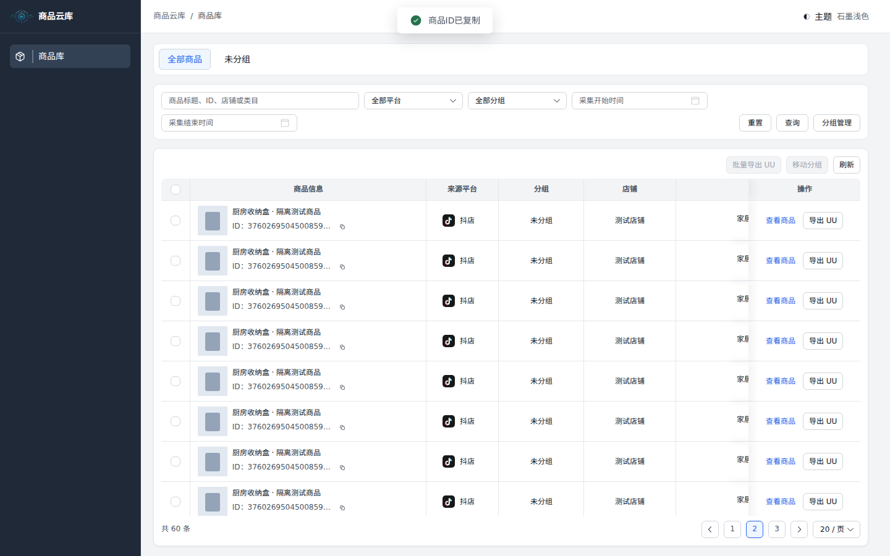
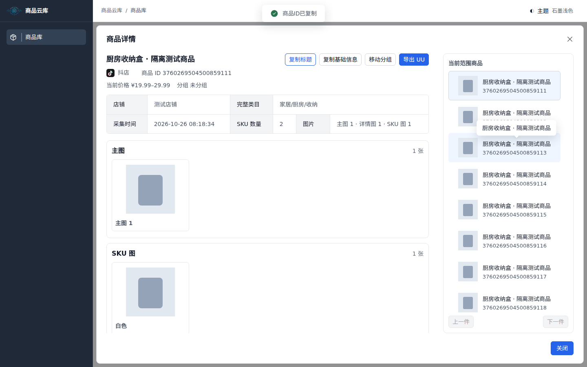
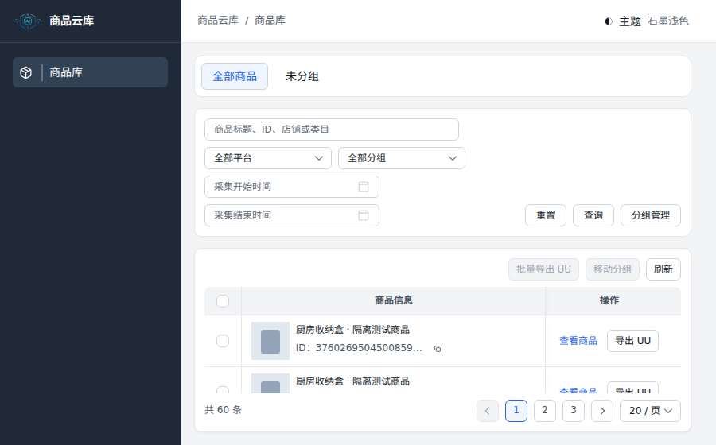
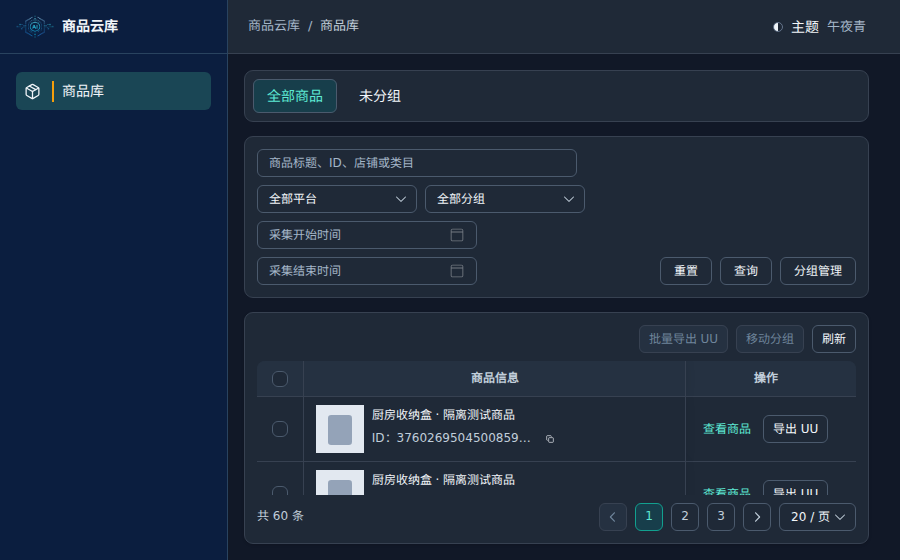

# V1 本轮验证记录

日期：2026-10-29。实现提交：`32d9c1da71d0fb39fee2c55b0330da1d82915f2e`。这些截图和测试使用合成商品，不是 NAS 生产数据。

## 已通过

- 中控原样复用文件 SHA-256 核验：49 项。
- 后端：36 项；包含原 Node 查询生成器与 Python SQL/参数差异检查、鉴权、失败响应、UU 文件校验/导出及路径范围。
- 前端：2 个测试文件、6 项；包含查询参数、上海秒级时间、选择/详情清理、旧响应保护、翻页总数复用和刷新。
- ESLint、Vue TypeScript 类型检查、Vite 生产构建通过。
- Chromium 浏览器：3 项；覆盖 228px 侧栏/54px 顶栏、表格内部滚动、固定分页、19 位 ID 复制且不误选/打开详情、详情/SKU、分页不重算总数、900×560 及四套主题、分组创建和重命名交互。
- 本地浏览器使用独立安装的 Chromium 153，隔离字体用于正确渲染中文，不增加项目运行依赖。CI 采用 Playwright 官方浏览器。

构建仍有单个 JS 块约 1.18 MB（gzip 338 KB）的体积提示。FastAPI 测试环境有 Starlette/httpx 弃用提示；均不是测试失败。

## CI 阻塞

[首次 push CI](https://github.com/guangyuxu512-cell/ProductDataCenter/actions/runs/40836646388) 和 [PR CI](https://github.com/guangyuxu512-cell/ProductDataCenter/actions/runs/40836698993) 均在启动任务前失败：三个 job 的 steps 为空、runner_id 为 0。

已用 GitHub 页面只读核对 Annotations：账号近期付款失败或需要增加支出额度，导致任务未开始。未修改 Billing、支出上限、仓库可见性或 Runner 设置。

因此 PostgreSQL 16 集成测试、Docker 实际构建仍为**未执行**，不能声明 CI Green、独立审查通过或具备生产发布条件。待账号问题解决后重跑最终 Candidate 的工作流，或在获授权的本地 Docker 环境执行同等检查。

未访问真实 NAS 数据库，没有部署、写入生产、APK/手机操作、真实采集或新的 30 万商品端到端压测。Windows `D:\商品云库` 未被本云端会话写入。

## 截图

商品列表：

商品详情：

小窗口与深色主题：

